<table width="100%" bgcolor="#0e1117" cellpadding="0" cellspacing="0" border="0" style="width: 100%; max-width: 100%; border-collapse: separate; border-spacing: 0; background-color: #0e1117; border: 1px solid #30363d; border-radius: 24px; box-shadow: 0 20px 60px rgba(0, 0, 0, 0.7); overflow: hidden;">
<tr>
<td align="center" style="padding: 24px 24px 36px; background-color: #0e1117;">

<!-- ================================================================= -->
<!-- 1. 3D METALLIC HERO BANNER (RESPONSIVE VIEWPORT)                 -->
<!-- ================================================================= -->
<picture>
  <source media="(max-width: 600px)" srcset="./assets/mobile/hero.svg?v=6" />
  
</picture>

<!-- ================================================================= -->
<!-- 2. PRIMARY ACTION & STRATEGY BUTTONS                              -->
<!-- ================================================================= -->

  
  &nbsp;
  

<!-- ================================================================= -->
<!-- 3. VERIFIED SOCIAL NETWORK BADGES                                 -->
<!-- ================================================================= -->

  
  &nbsp;
  
  &nbsp;
  
  &nbsp;
  
  &nbsp;
  

<!-- ================================================================= -->
<!-- 4. LIVE METRICS & ACTIVITY STREAK                                 -->
<!-- ================================================================= -->

  
  &nbsp;
  

  

<!-- ================================================================= -->
<!-- 5. ARCHITECTURAL ECOSYSTEM MAP (MERMAID)                         -->
<!-- ================================================================= -->

### 🗺️ System Architecture & Engineering Graph

```mermaid
flowchart LR
    subgraph MultiAgent["Autonomous Multi-Agent Core"]
        A1["Hadron<br/>(AI PR Review Engine)"]
        A2["AmberClaw<br/>(Persistent Assistant)"]
        A3["agent-skills<br/>(Anchor Orchestrator)"]
    end

    subgraph MLOps["Production MLOps & Intelligence"]
        B1["WaferGuard<br/>(Semiconductor DVC)"]
        B2["SaYoPillow<br/>(Sleep Biosignals)"]
        B3["Drug Efficacy<br/>(Clinical Regression)"]
    end

    subgraph Edge["Edge Systems & Mobile Delivery"]
        C1["Sureword<br/>(Healthcare Speech AI)"]
        C2["SnapText<br/>(On-Device OCR)"]
        C3["NetSweep<br/>(Network Recon Pipeline)"]
    end

    MultiAgent <===>|MCP & Vector RRF| MLOps
    MLOps <===>|Low-Latency Serving| Edge
```

<!-- ================================================================= -->
<!-- 6. FEATURED FLAGSHIP SYSTEMS (FAANG-GRADE CARDS)                  -->
<!-- ================================================================= -->

### ⚡ Production Flagship Systems
Architectural engineering showcases built for multi-agent consensus, sub-150ms vector search, clinical speech entry, and industrial MLOps.

<!-- CARD 1: HADRON -->
<table width="100%" bgcolor="#161b22" cellpadding="16" cellspacing="0" border="0" style="border: 1px solid #30363d; border-radius: 14px; margin-bottom: 16px;">
<tr>
<td>
  <table width="100%" border="0" cellpadding="0" cellspacing="0">
    <tr>
      <td align="left">
        <h3 style="margin: 0; font-size: 1.25em;">🚀 <a href="https://github.com/krishujeniya/Hadron">Hadron</a></h3>
      </td>
      <td align="right">
        
        
      </td>
    </tr>
  </table>
  

    <b>Autonomous Multi-Agent PR Review Engine.</b> Evaluates incoming pull request diffs, executes DiskANN reciprocal rank fusion vector search over AST call paths, and detects logic defects, race conditions, and OWASP vulnerabilities prior to merge.
  

  

    <code>⚡ Sub-150ms Retrieval</code> · 
    <code>🤖 Cyclic LangGraph State Machine</code> · 
    <code>📊 DiskANN Reciprocal Rank Fusion</code> · 
    <code>🔒 Zero Root Baggage</code>
  

  

    
    
    
    
    
    
  

  

    <a href="https://hadron.vercel.app"><b>[⚡ Live Demo ↗]</b></a> &nbsp;•&nbsp; 
    <a href="https://github.com/krishujeniya/Hadron"><b>[📁 GitHub Repository ↗]</b></a> &nbsp;•&nbsp; 
    <a href="https://github.com/krishujeniya/Hadron#readme"><b>[📄 Technical Report ↗]</b></a>
  

</td>
</tr>
</table>

<!-- CARD 2: AGENT-SKILLS -->
<table width="100%" bgcolor="#161b22" cellpadding="16" cellspacing="0" border="0" style="border: 1px solid #30363d; border-radius: 14px; margin-bottom: 16px;">
<tr>
<td>
  <table width="100%" border="0" cellpadding="0" cellspacing="0">
    <tr>
      <td align="left">
        <h3 style="margin: 0; font-size: 1.25em;">🛠️ <a href="https://github.com/krishujeniya/agent-skills">agent-skills</a></h3>
      </td>
      <td align="right">
        
        
      </td>
    </tr>
  </table>
  

    <b>Unified Autonomous AI Agent Frameworks &amp; Tooling Monorepo.</b> Houses the Anchor 5-gate deterministic workflow orchestrator, Aegis verification framework, multi-agent deliberation council CLI, and local Model Context Protocol (MCP) integrations.
  

  

    <code>🛡️ Anchor 5-Gate Orchestration</code> · 
    <code>🔌 MCP Tool Server Suite</code> · 
    <code>⚖️ Deliberation Council CLI</code> · 
    <code>📚 Official GitHub Pages Docs</code>
  

  

    
    
    
    
    
  

  

    <a href="https://krishujeniya.github.io/agent-skills/"><b>[📚 Documentation Site ↗]</b></a> &nbsp;•&nbsp; 
    <a href="https://github.com/krishujeniya/agent-skills"><b>[📁 GitHub Repository ↗]</b></a> &nbsp;•&nbsp; 
    <a href="https://github.com/krishujeniya/agent-skills/blob/main/CITATION.cff"><b>[🎓 Citation CFF ↗]</b></a>
  

</td>
</tr>
</table>

<!-- CARD 3: AMBERCLAW -->
<table width="100%" bgcolor="#161b22" cellpadding="16" cellspacing="0" border="0" style="border: 1px solid #30363d; border-radius: 14px; margin-bottom: 16px;">
<tr>
<td>
  <table width="100%" border="0" cellpadding="0" cellspacing="0">
    <tr>
      <td align="left">
        <h3 style="margin: 0; font-size: 1.25em;">🧠 <a href="https://github.com/krishujeniya/AmberClaw">AmberClaw</a></h3>
      </td>
      <td align="right">
        
        
      </td>
    </tr>
  </table>
  

    <b>Lightweight Personal AI Assistant Framework.</b> Connects any LLM to local MCP tool runtimes with persistent conversational memory across Telegram, Discord, and Slack in under 4,000 lines of auditable Python.
  

  

    <code>💬 Multi-Channel Dispatch</code> · 
    <code>🧠 Persistent SQLite Context</code> · 
    <code>⚡ 4k LOC Auditable Architecture</code> · 
    <code>🔌 Pluggable MCP Client</code>
  

  

    
    
    
    
    
    
  

  

    <a href="https://github.com/krishujeniya/AmberClaw"><b>[📁 GitHub Repository ↗]</b></a> &nbsp;•&nbsp; 
    <a href="https://github.com/krishujeniya/AmberClaw#benchmarks"><b>[📊 Benchmark Suite ↗]</b></a> &nbsp;•&nbsp; 
    <a href="https://github.com/krishujeniya/AmberClaw#architecture"><b>[🏛️ Architecture ↗]</b></a>
  

</td>
</tr>
</table>

<!-- CARD 4: SUREWORD -->
<table width="100%" bgcolor="#161b22" cellpadding="16" cellspacing="0" border="0" style="border: 1px solid #30363d; border-radius: 14px; margin-bottom: 16px;">
<tr>
<td>
  <table width="100%" border="0" cellpadding="0" cellspacing="0">
    <tr>
      <td align="left">
        <h3 style="margin: 0; font-size: 1.25em;">🩺 <a href="https://github.com/krishujeniya/Sureword">Sureword</a></h3>
      </td>
      <td align="right">
        
        
      </td>
    </tr>
  </table>
  

    <b>Voice-to-Form Frontline Visit Entry with Selective Clarification.</b> Automates clinical encounter capture using Gnani Prisma and Timbre ASR models with active clarification triggers on ambiguous medical terminology.
  

  

    <code>🎙️ Specialized Medical ASR</code> · 
    <code>❓ Selective Clarification Loops</code> · 
    <code>📋 Structured Clinical Form Synthesis</code> · 
    <code>🐳 Docker Containerized</code>
  

  

    
    
    
    
    
  

  

    <a href="https://github.com/krishujeniya/Sureword"><b>[📁 GitHub Repository ↗]</b></a> &nbsp;•&nbsp; 
    <a href="https://github.com/krishujeniya/Sureword#pipeline-architecture"><b>[🔬 Speech Pipeline ↗]</b></a>
  

</td>
</tr>
</table>

<!-- CARD 5: WAFERGUARD -->
<table width="100%" bgcolor="#161b22" cellpadding="16" cellspacing="0" border="0" style="border: 1px solid #30363d; border-radius: 14px; margin-bottom: 16px;">
<tr>
<td>
  <table width="100%" border="0" cellpadding="0" cellspacing="0">
    <tr>
      <td align="left">
        <h3 style="margin: 0; font-size: 1.25em;">🛡️ <a href="https://github.com/krishujeniya/WaferGuard">WaferGuard</a></h3>
      </td>
      <td align="right">
        
        
      </td>
    </tr>
  </table>
  

    <b>Semiconductor Wafer Anomaly Detection &amp; Predictive Maintenance Pipeline.</b> Implements end-to-end data versioning (DVC), automated validation gates, and modular machine learning workflows for semiconductor yield optimization.
  

  

    <code>🏭 Semiconductor Yield Protection</code> · 
    <code>🔄 DVC Version Control</code> · 
    <code>📈 Automated Metric Tracking</code> · 
    <code>⚙️ Production Makefile Target Matrix</code>
  

  

    
    
    
    
    
  

  

    <a href="https://github.com/krishujeniya/WaferGuard"><b>[📁 GitHub Repository ↗]</b></a> &nbsp;•&nbsp; 
    <a href="https://github.com/krishujeniya/WaferGuard#dvc-pipeline-lifecycle"><b>[🔄 DVC Lifecycle ↗]</b></a> &nbsp;•&nbsp; 
    <a href="https://github.com/krishujeniya/WaferGuard/blob/main/CITATION.cff"><b>[🎓 Citation CFF ↗]</b></a>
  

</td>
</tr>
</table>

<!-- CARD 6: HAJRI.AI -->
<table width="100%" bgcolor="#161b22" cellpadding="16" cellspacing="0" border="0" style="border: 1px solid #30363d; border-radius: 14px; margin-bottom: 16px;">
<tr>
<td>
  <table width="100%" border="0" cellpadding="0" cellspacing="0">
    <tr>
      <td align="left">
        <h3 style="margin: 0; font-size: 1.25em;">👁️ <a href="https://github.com/krishujeniya/Hajri.ai">Hajri.ai</a></h3>
      </td>
      <td align="right">
        
        
      </td>
    </tr>
  </table>
  

    <b>Anti-Spoofing Computer Vision Attendance System.</b> Utilizes active liveness detection and facial recognition to prevent static photo and screen replay attacks in institutional attendance environments.
  

  

    <code>🛡️ Anti-Spoofing Liveness Verification</code> · 
    <code>👁️ Deep Metric Facial Embedding</code> · 
    <code>🐳 Containerized Microservice</code>
  

  

    
    
    
    
    
  

  

    <a href="https://github.com/krishujeniya/Hajri.ai"><b>[📁 GitHub Repository ↗]</b></a> &nbsp;•&nbsp; 
    <a href="https://github.com/krishujeniya/Hajri.ai#architecture"><b>[🏛️ Architecture Flow ↗]</b></a>
  

</td>
</tr>
</table>

<!-- CARD 7: SNAPTEXT-OCR -->
<table width="100%" bgcolor="#161b22" cellpadding="16" cellspacing="0" border="0" style="border: 1px solid #30363d; border-radius: 14px; margin-bottom: 16px;">
<tr>
<td>
  <table width="100%" border="0" cellpadding="0" cellspacing="0">
    <tr>
      <td align="left">
        <h3 style="margin: 0; font-size: 1.25em;">📱 <a href="https://github.com/krishujeniya/snaptext-ocr">SnapText</a></h3>
      </td>
      <td align="right">
        
        
      </td>
    </tr>
  </table>
  

    <b>On-Device Optical Character Recognition (OCR) Mobile Utility.</b> Extracts structured printed text directly from camera snapshots with 100% on-device local computation, zero cloud dependencies, and instant export.
  

  

    <code>🔒 100% On-Device Zero Cloud</code> · 
    <code>⚡ Real-Time ML Kit Inference</code> · 
    <code>📱 Responsive Flutter Architecture</code>
  

  

    
    
    
    
  

  

    <a href="https://github.com/krishujeniya/snaptext-ocr"><b>[📁 GitHub Repository ↗]</b></a> &nbsp;•&nbsp; 
    <a href="https://github.com/krishujeniya/snaptext-ocr#features"><b>[✨ Feature Matrix ↗]</b></a>
  

</td>
</tr>
</table>

<!-- CARD 8: NETSWEEP -->
<table width="100%" bgcolor="#161b22" cellpadding="16" cellspacing="0" border="0" style="border: 1px solid #30363d; border-radius: 14px; margin-bottom: 8px;">
<tr>
<td>
  <table width="100%" border="0" cellpadding="0" cellspacing="0">
    <tr>
      <td align="left">
        <h3 style="margin: 0; font-size: 1.25em;">🌐 <a href="https://github.com/krishujeniya/NetSweep">NetSweep</a></h3>
      </td>
      <td align="right">
        
        
      </td>
    </tr>
  </table>
  

    <b>Automated Network Reconnaissance &amp; Penetration Testing Pipeline.</b> High-speed Bash orchestration wrapping Nmap discovery, TCP/UDP port scanning, service version detection, and OS fingerprinting into timestamped audit logs.
  

  

    <code>🔍 Automated Port Auditing</code> · 
    <code>🛡️ Service &amp; OS Fingerprinting</code> · 
    <code>📜 Structured Audit Artifacts</code>
  

  

    
    
    
    
  

  

    <a href="https://github.com/krishujeniya/NetSweep"><b>[📁 GitHub Repository ↗]</b></a> &nbsp;•&nbsp; 
    <a href="https://github.com/krishujeniya/NetSweep#usage"><b>[🛠️ Quickstart ↗]</b></a>
  

</td>
</tr>
</table>

<!-- ================================================================= -->
<!-- 7. TECHNICAL CAPABILITY MATRIX                                    -->
<!-- ================================================================= -->

### 🛠️ Technical Competencies &amp; Stack

<table width="100%" bgcolor="#161b22" cellpadding="14" cellspacing="0" border="0" style="border: 1px solid #30363d; border-radius: 12px;">
<tr>
<td width="50%" valign="top" style="border-right: 1px solid #30363d; padding-right: 16px;">
  <h4 style="margin: 0 0 8px; color: #58a6ff;">🤖 Autonomous Agent &amp; LLM Systems</h4>
  

    LangGraph State Graphs · Model Context Protocol (MCP) · LangChain · DiskANN RRF Vector Search · Multi-Agent Deliberation Councils · RAG Pipelines · LiteLLM Unified Routing · Prompt Engineering
  

  <h4 style="margin: 16px 0 8px; color: #58a6ff;">📊 Machine Learning &amp; MLOps</h4>
  

    PyTorch · Scikit-Learn · DVC (Data Version Control) · SHAP Explainability · Computer Vision (OpenCV) · Biosignal Telemetry · Sensor Fusion (HAR) · Time-Series Forecasting
  

</td>
<td width="50%" valign="top" style="padding-left: 16px;">
  <h4 style="margin: 0 0 8px; color: #58a6ff;">⚙️ Backend &amp; Distributed Systems</h4>
  

    Python 3.12 · FastAPI · PostgreSQL · SQLite · Redis · Docker &amp; Compose · Bash Shell Scripting · Linux Microservices · GitHub Actions CI/CD
  

  <h4 style="margin: 16px 0 8px; color: #58a6ff;">📱 Frontend &amp; Cross-Platform Mobile</h4>
  

    Flutter &amp; Dart · Next.js 15 · React 19 · TypeScript · Tailwind CSS · Pure SCSS · Glassmorphism &amp; Responsive Fluid Layouts
  

</td>
</tr>
</table>

<!-- ================================================================= -->
<!-- 8. RESEARCH, DATASETS & BENCHMARKS                                -->
<!-- ================================================================= -->

### 🔬 Research, Datasets &amp; Public Benchmarks

<table width="100%" bgcolor="#161b22" cellpadding="14" cellspacing="0" border="0" style="border: 1px solid #30363d; border-radius: 12px;">
<tr>
<td>
  <ul style="margin: 0; padding-left: 20px; line-height: 1.8; color: #c9d1d9;">
    <li>📈 <b><a href="https://huggingface.co/datasets/krishujeniya/Salary_of_Data_Professions">Salary of Data Professions Dataset ↗</a></b>: Curated open-source benchmark analyzing compensation trajectories and experience curves across worldwide data science roles.</li>
    <li>🧬 <b><a href="https://github.com/krishujeniya/stress-level-prediction">SaYoPillow Physiological Sleep Stress Classification ↗</a></b>: 5-class sleep biosignal classifier featuring SHAP feature attribution and real-time Streamlit telemetry.</li>
    <li>💊 <b><a href="https://github.com/krishujeniya/drug-effectiveness-prediction">Clinical Drug Efficacy Prediction ↗</a></b>: Machine learning framework predicting clinical trial response and patient drug efficacy from multi-variable medical telemetry.</li>
    <li>🏃 <b><a href="https://github.com/krishujeniya/fitness-activity-recognition">Sensor-Based Human Activity Recognition (HAR) ↗</a></b>: Accelerometer and gyroscope telemetry classifier modeling physical activity patterns.</li>
    <li>🧪 <b><a href="https://huggingface.co/krishujeniya/spaces">Interactive Spaces on Hugging Face ↗</a></b>: Live browser deployments and experimental models.</li>
    <li>🏆 <b><a href="https://www.kaggle.com/krishujeniya/datasets">Kaggle Datasets &amp; Notebooks ↗</a></b>: Reproducible data science notebooks and feature engineering pipelines.</li>
  </ul>
</td>
</tr>
</table>

<!-- ================================================================= -->
<!-- 9. CONTACT & STRATEGIC ENGAGEMENT                                 -->
<!-- ================================================================= -->

<h3 style="margin-bottom: 8px;">Let's Build Something High-Impact</h3>

  Available for autonomous agent system design, production MLOps engineering, vector search architectures, and high-impact machine learning collaboration.

  
  &nbsp;
  

  
    <a href="https://krishujeniya.github.io/krishujeniya/"><b>Live Portfolio</b></a> · 
    <a href="mailto:social.krishujeniya@gmail.com"><b>social.krishujeniya@gmail.com</b></a> · 
    <a href="https://github.com/krishujeniya"><b>GitHub (@krishujeniya)</b></a> · 
    <a href="https://linkedin.com/in/krishujeniya"><b>LinkedIn</b></a>
  

</td>
</tr>
</table>

