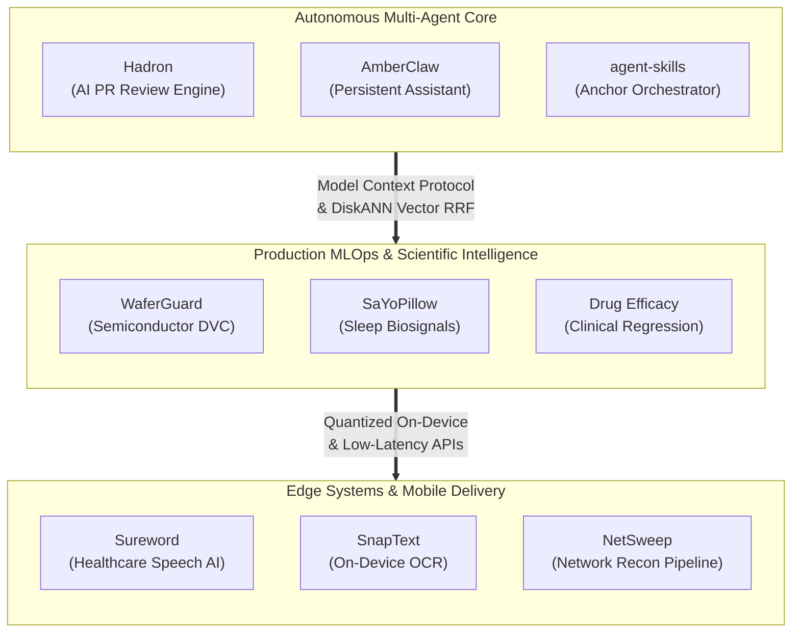

  <picture>
    <source media="(max-width: 600px)" srcset="./assets/mobile/hero.svg?v=9" />
    
  </picture>

<!-- ================================================================= -->
<!-- 1. PRIMARY STRATEGY & PORTFOLIO CTA BUTTONS (FLUID WRAP)          -->
<!-- ================================================================= -->

  
  

<!-- ================================================================= -->
<!-- 2. VERIFIED SOCIAL NETWORK CHANNELS (FLUID INLINE WRAP)           -->
<!-- ================================================================= -->

  
  
  
  
  

<!-- ================================================================= -->
<!-- 3. LIVE TELEMETRY, COMMUNITY METRICS & STREAK WIDGET              -->
<!-- ================================================================= -->

  
  

  

---

<!-- ================================================================= -->
<!-- 4. ARCHITECTURAL ECOSYSTEM MAP (TOP-DOWN AUTO-ADJUSTING)          -->
<!-- ================================================================= -->
### 🗺️ System Architecture &amp; Engineering Graph

---

<!-- ================================================================= -->
<!-- 5. FEATURED FLAGSHIP SYSTEMS (AUTO-ADJUSTING 100% WIDTH CARDS)    -->
<!-- ================================================================= -->
### ⚡ Production Flagship Systems
Modular engineering showcases built for multi-agent consensus, sub-150ms vector search, frontline clinical speech capture, and industrial MLOps.

<!-- CARD 1: HADRON -->
<table width="100%">
<tr>
<td>

### 🚀 [Hadron ↗](https://github.com/krishujeniya/Hadron)

  

**Autonomous Multi-Agent PR Review Engine.** Evaluates incoming pull request diffs, executes DiskANN reciprocal rank fusion vector search over AST call paths, and detects logic defects, race conditions, and OWASP vulnerabilities prior to merge.

`⚡ Sub-150ms Retrieval` · `🤖 Cyclic LangGraph State Machine` · `📊 DiskANN Reciprocal Rank Fusion` · `🔒 AST Security Gate`

    

**[⚡ Live Demo ↗](https://hadron.vercel.app)** • **[📁 GitHub Repository ↗](https://github.com/krishujeniya/Hadron)** • **[📄 Technical Report ↗](https://github.com/krishujeniya/Hadron#readme)**

</td>
</tr>
</table>

<!-- CARD 2: AGENT-SKILLS -->
<table width="100%">
<tr>
<td>

### 🛠️ [agent-skills ↗](https://github.com/krishujeniya/agent-skills)

  

**Unified Autonomous AI Agent Frameworks &amp; Tooling Monorepo.** Houses the Anchor 5-gate deterministic workflow orchestrator, Aegis verification framework, multi-agent deliberation council CLI, and local Model Context Protocol (MCP) integrations.

`🛡️ Anchor 5-Gate Orchestration` · `🔌 MCP Tool Server Suite` · `⚖️ Deliberation Council CLI` · `📚 GitHub Pages Documentation`

   

**[📚 Documentation Site ↗](https://krishujeniya.github.io/agent-skills/)** • **[📁 GitHub Repository ↗](https://github.com/krishujeniya/agent-skills)** • **[🎓 Citation CFF ↗](https://github.com/krishujeniya/agent-skills/blob/main/CITATION.cff)**

</td>
</tr>
</table>

<!-- CARD 3: AMBERCLAW -->
<table width="100%">
<tr>
<td>

### 🧠 [AmberClaw ↗](https://github.com/krishujeniya/AmberClaw)

  

**Lightweight Personal AI Assistant Framework.** Connects any LLM to local MCP tool runtimes with persistent conversational memory across Telegram, Discord, and Slack in under 4,000 lines of auditable Python.

`💬 Multi-Channel Dispatch` · `🧠 Persistent SQLite Context` · `⚡ 4k LOC Auditable Architecture` · `🔌 Pluggable MCP Client`

    

**[📁 GitHub Repository ↗](https://github.com/krishujeniya/AmberClaw)** • **[📊 Benchmark Suite ↗](https://github.com/krishujeniya/AmberClaw#benchmarks)** • **[🏛️ Architecture ↗](https://github.com/krishujeniya/AmberClaw#architecture)**

</td>
</tr>
</table>

<!-- CARD 4: SUREWORD -->
<table width="100%">
<tr>
<td>

### 🩺 [Sureword ↗](https://github.com/krishujeniya/Sureword)

  

**Voice-to-Form Frontline Visit Entry with Selective Clarification.** Automates clinical encounter capture using Gnani Prisma and Timbre ASR models with active clarification triggers on ambiguous medical terminology.

`🎙️ Medical ASR Pipeline` · `❓ Selective Clarification Loops` · `📋 Clinical Form Synthesis` · `🐳 Docker Containerized`

   

**[📁 GitHub Repository ↗](https://github.com/krishujeniya/Sureword)** • **[🔬 Speech Pipeline ↗](https://github.com/krishujeniya/Sureword#pipeline-architecture)**

</td>
</tr>
</table>

<!-- CARD 5: WAFERGUARD -->
<table width="100%">
<tr>
<td>

### 🛡️ [WaferGuard ↗](https://github.com/krishujeniya/WaferGuard)

  

**Semiconductor Wafer Anomaly Detection &amp; Predictive Maintenance Pipeline.** Implements end-to-end data versioning (DVC), automated validation gates, and modular machine learning workflows for semiconductor yield optimization.

`🏭 Semiconductor Yield Protection` · `🔄 DVC Version Control` · `📈 Automated Metric Tracking` · `⚙️ Production Makefile Target Matrix`

   

**[📁 GitHub Repository ↗](https://github.com/krishujeniya/WaferGuard)** • **[🔄 DVC Lifecycle ↗](https://github.com/krishujeniya/WaferGuard#dvc-pipeline-lifecycle)** • **[🎓 Citation CFF ↗](https://github.com/krishujeniya/WaferGuard/blob/main/CITATION.cff)**

</td>
</tr>
</table>

<!-- CARD 6: HAJRI.AI -->
<table width="100%">
<tr>
<td>

### 👁️ [Hajri.ai ↗](https://github.com/krishujeniya/Hajri.ai)

  

**Anti-Spoofing Computer Vision Attendance System.** Utilizes active liveness detection and facial recognition to prevent static photo and screen replay attacks in institutional attendance environments.

`🛡️ Anti-Spoofing Liveness Verification` · `👁️ Deep Metric Facial Embedding` · `🐳 Containerized Microservice`

   

**[📁 GitHub Repository ↗](https://github.com/krishujeniya/Hajri.ai)** • **[🏛️ Architecture Flow ↗](https://github.com/krishujeniya/Hajri.ai#architecture)**

</td>
</tr>
</table>

<!-- CARD 7: SNAPTEXT-OCR -->
<table width="100%">
<tr>
<td>

### 📱 [SnapText ↗](https://github.com/krishujeniya/snaptext-ocr)

  

**On-Device Optical Character Recognition (OCR) Mobile Utility.** Extracts structured printed text directly from camera snapshots with 100% on-device local computation, zero cloud dependencies, and instant export.

`🔒 100% On-Device Zero Cloud` · `⚡ Real-Time ML Kit Inference` · `📱 Responsive Flutter Architecture`

  

**[📁 GitHub Repository ↗](https://github.com/krishujeniya/snaptext-ocr)** • **[✨ Feature Matrix ↗](https://github.com/krishujeniya/snaptext-ocr#features)**

</td>
</tr>
</table>

<!-- CARD 8: NETSWEEP -->
<table width="100%">
<tr>
<td>

### 🌐 [NetSweep ↗](https://github.com/krishujeniya/NetSweep)

  

**Automated Network Reconnaissance &amp; Penetration Testing Pipeline.** High-speed Bash orchestration wrapping Nmap discovery, TCP/UDP port scanning, service version detection, and OS fingerprinting into timestamped audit logs.

`🔍 Automated Port Auditing` · `🛡️ Service &amp; OS Fingerprinting` · `📜 Structured Audit Artifacts`

  

**[📁 GitHub Repository ↗](https://github.com/krishujeniya/NetSweep)** • **[🛠️ Quickstart ↗](https://github.com/krishujeniya/NetSweep#usage)**

</td>
</tr>
</table>

---

<!-- ================================================================= -->
<!-- 6. TECHNICAL COMPETENCY MATRIX (AUTO-ADJUSTING 100% WIDTH CARDS)  -->
<!-- ================================================================= -->
### 🛠️ Technical Competencies &amp; Toolchain

<!-- DOMAIN 1 -->
<table width="100%">
<tr>
<td>

#### 🤖 Autonomous Multi-Agent &amp; LLM Systems

LangGraph Cyclic State Graphs · Model Context Protocol (MCP) · LangChain · DiskANN Reciprocal Rank Fusion (RRF) · Multi-Agent Deliberation Council CLI · RAG Architecture · LiteLLM Unified Routing · Context Window Economics

</td>
</tr>
</table>

<!-- DOMAIN 2 -->
<table width="100%">
<tr>
<td>

#### 📊 Machine Learning &amp; Production MLOps

PyTorch · Scikit-Learn · DVC (Data Version Control) Lineage · SHAP Explainability &amp; Feature Attribution · Computer Vision (OpenCV) Anti-Spoofing · Biosignal Telemetry · Sensor Fusion HAR · Time-Series Forecasting

</td>
</tr>
</table>

<!-- DOMAIN 3 -->
<table width="100%">
<tr>
<td>

#### ⚙️ Backend &amp; Distributed Infrastructure

Python 3.12 · FastAPI Asynchronous Services · PostgreSQL · SQLite Embedded Memory · Redis Caching · Docker Containerization · Bash Shell Automation · Linux Microservices · GitHub Actions Automated CI/CD

</td>
</tr>
</table>

<!-- DOMAIN 4 -->
<table width="100%">
<tr>
<td>

#### 📱 Cross-Platform Mobile &amp; Frontend

Flutter &amp; Dart · Next.js 15 App Router · React 19 · TypeScript · Tailwind CSS · Pure SCSS Animations · On-Device Google ML Kit · Responsive Glassmorphism Mobile-First Design

</td>
</tr>
</table>

---

<!-- ================================================================= -->
<!-- 7. RESEARCH, DATASETS & PUBLIC BENCHMARKS                         -->
<!-- ================================================================= -->
### 🔬 Research, Datasets &amp; Public Benchmarks

<table width="100%">
<tr>
<td>

- 📈 **[Salary of Data Professions Dataset ↗](https://huggingface.co/datasets/krishujeniya/Salary_of_Data_Professions)**: Curated open-source benchmark analyzing compensation trajectories and experience curves across worldwide data science roles.
- 🧬 **[SaYoPillow Physiological Sleep Stress Classification ↗](https://github.com/krishujeniya/stress-level-prediction)**: 5-class sleep biosignal classifier featuring SHAP feature attribution and real-time Streamlit telemetry.
- 💊 **[Clinical Drug Efficacy Prediction ↗](https://github.com/krishujeniya/drug-effectiveness-prediction)**: Machine learning framework predicting clinical trial response and patient drug efficacy from multi-variable medical telemetry.
- 🏃 **[Sensor-Based Human Activity Recognition (HAR) ↗](https://github.com/krishujeniya/fitness-activity-recognition)**: Accelerometer and gyroscope telemetry classifier modeling physical activity patterns.
- 🧪 **[Interactive Spaces on Hugging Face ↗](https://huggingface.co/krishujeniya/spaces)**: Live browser deployments and experimental models.
- 🏆 **[Kaggle Datasets &amp; Notebooks ↗](https://www.kaggle.com/krishujeniya/datasets)**: Reproducible data science notebooks and feature engineering pipelines.

</td>
</tr>
</table>

---

<!-- ================================================================= -->
<!-- 8. CONTACT & STRATEGIC ENGAGEMENT (AUTO-ADJUSTING)                -->
<!-- ================================================================= -->

### Let's Build Something High-Impact

Available for autonomous agent system design, production MLOps engineering, vector search architectures, and high-impact machine learning collaboration.

  
  

  <a href="https://krishujeniya.github.io/krishujeniya/"><b>Live Portfolio</b></a> • 
  <a href="mailto:social.krishujeniya@gmail.com"><b>social.krishujeniya@gmail.com</b></a> • 
  <a href="https://github.com/krishujeniya"><b>GitHub (@krishujeniya)</b></a> • 
  <a href="https://linkedin.com/in/krishujeniya"><b>LinkedIn</b></a>

